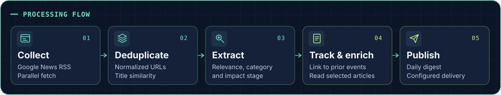

<p align="center">
  
</p>

# SEA Credit Radar

监测印尼、菲律宾、新加坡和越南的消费信贷动态。项目把新闻抽取成结构化事件，按获客、准入、额度、定价和贷后标注业务影响，并用 SQLite 把后续报道接回已有事件。

## 一次真实运行

```text
新事件 14 · 进展更新 0 · 模型 deepseek-chat · tokens 60640+5173 · 成本 $0.0192
```

这是 2026-09-21 简报的运行摘要，当天处理了 223 条候选。简报保留来源链接、影响环节和置信度。另一个样例用合成后续新闻展示「进展更新」。[真实简报](docs/sample-day1.md) · [简报终端截图](docs/sample-day1.svg) · [进展更新样例](docs/sample-day2.md)

## 架构



URL 和标题去重先过滤转载。模型抽取相关性和影响环节后，管线把后续报道关联到旧事件。监管事件或置信度低于 0.6 的事件会进入正文解读分支，再统一生成简报。

## 快速开始

使用 Python 3.11 或 3.12。安装依赖，把模型密钥填入 `.env`，再运行一次简报流程。

```bash
python -m venv .venv
source .venv/bin/activate
python -m pip install -r requirements.txt
cp .env.example .env
python -m radar.cli run --dry-run
```

`--dry-run` 跳过推送，仍会抓取新闻、调用模型、写库并输出 `data/digests/YYYY-MM-DD.md`。离线测试使用 `python -m pytest`。

## CLI 速查

| 命令 | 用途 |
| --- | --- |
| `python -m radar.cli run [--dry-run]` | 抓取、抽取、生成简报，按配置推送 |
| `python -m radar.cli fetch` | 只抓取新闻并入库 |
| `python -m radar.cli extract` | 抽取数据库中尚未处理的条目 |
| `python -m radar.cli backfill --days 7` | 按发布日期回填，跳过推送 |
| `python -m radar.cli digest --date 2026-09-21` | 读取本地数据库并重绘指定日期的简报 |
| `python -m radar.cli stats` | 查看库内条目状态统计 |
| `python -m eval.run_eval --testset eval/holdout.jsonl --repeat 3` | 重跑留出集评估 |

<details>
<summary>留出集结果与口径</summary>

以下是 `deepseek-chat` 在 29 条留出样本上的三次均值。

| 提示词 | 推送准确率 | 漏报率 | 影响环节 F1 |
| --- | ---: | ---: | ---: |
| `extract-v1` | 96.6% | 7.7% | 73.3% |
| `extract-v2` | 94.3% | 7.7% | 78.5% |

v2 的影响环节 F1 上升 5.2 个百分点，推送判断的改善未得到留出集支持。留出集 29 条，标注未经信贷领域专家复核。生效日期和跨天事件归并还缺独立的评估标签。[留出集报告](eval/results/20260921-065855_holdout_compare.md) · [模型对比记录](eval/results/history.jsonl)

</details>

<details>
<summary>模型、定时运行与目录</summary>

[`.env.example`](.env.example) 列出 `LLM_BASE_URL`、`LLM_API_KEY`、`LLM_MODEL` 和推送配置。评估时可用 `模型名@档案名` 同时比较多个模型。[定时工作流](.github/workflows/daily.yml) 在北京时间 08:00 运行，使用 Actions 缓存延续 SQLite 状态。推送方式通过仓库变量 `NOTIFY_METHOD` 设置，可用 `serverchan` 或 `email`。

| 路径 | 内容 |
| --- | --- |
| [`config.yaml`](config.yaml) | 数据源、阈值、价格和推送配置 |
| [`radar/`](radar/) | 采集、抽取、事件归并、存储和简报 |
| [`eval/`](eval/) | 开发集、留出集、评估脚本和结果 |
| [`docs/`](docs/)、[`tests/`](tests/) | 简报样例、离线测试 |
| [`SEA-Credit-Radar-SPEC.md`](SEA-Credit-Radar-SPEC.md) | 需求、数据模型与验收标准 |

</details>
