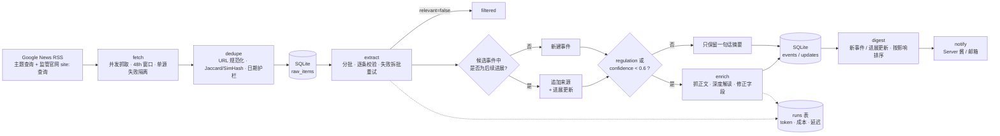
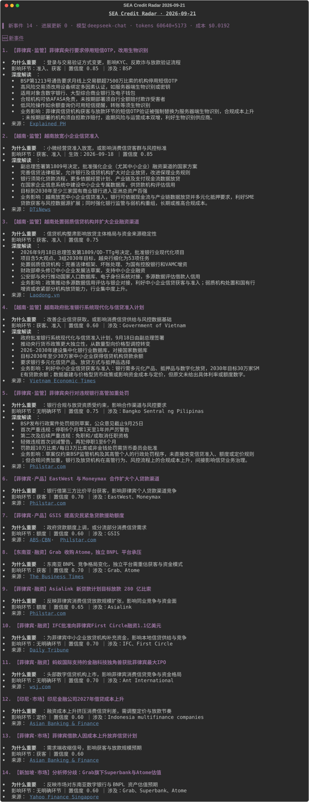
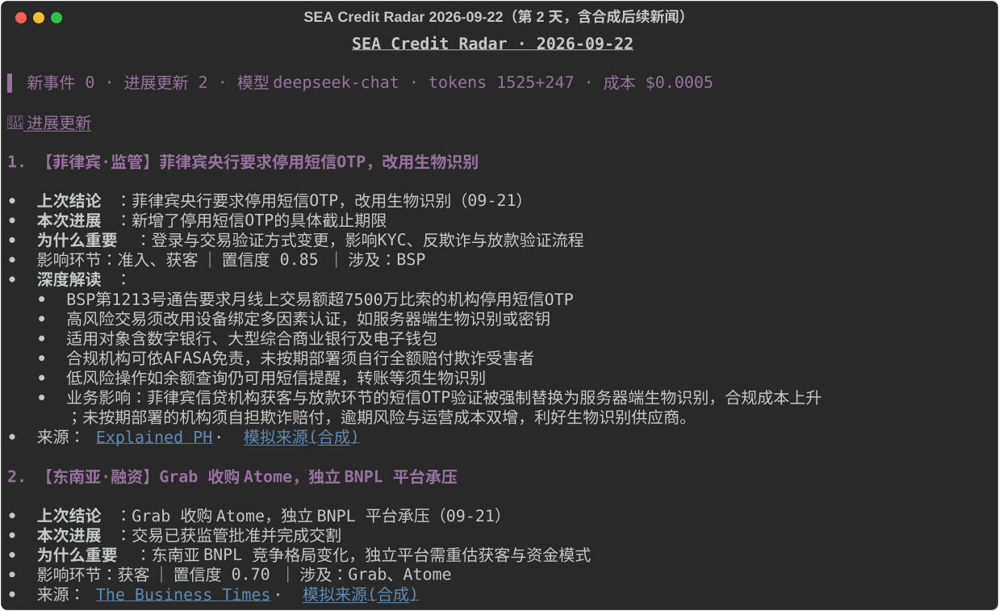

# SEA Credit Radar

每日运行的**东南亚消费信贷情报 Agent**：监测印尼、菲律宾、新加坡、越南的数字信贷与监管动态，把非结构化新闻抽取成结构化记录，**跨天追踪同一事件的进展**，并按「对信贷业务哪个环节有影响」分类推送。

与常见「新闻摘要」工作流的区别：

| | 做法 |
|---|---|
| 结构化抽取 | 不只写摘要：抽出国家、类别、涉及机构、影响环节（获客 / 准入 / 额度 / 定价 / 贷后）、生效日期、置信度 |
| 状态记忆 | SQLite 持久化事件；新新闻若是旧事件的后续，标为「进展更新」并附上次结论 |
| 分支处理 | 监管类或低置信度事件才抓全文深度解读，其余只做一句话摘要 |
| 效果评估 | 标注开发集 + 留出集，量化准确率 / 漏报率；prompt 与模型都可 A/B，结果带版本落盘 |
| 成本可见 | 每次模型调用的 token、估算成本、延迟都写入 `runs` 表 |

> **先看这里：哪些是验证过的，哪些没有。** 见文末「[验证状态与已知局限](#验证状态与已知局限)」。

## 架构



所有大模型调用都经 `radar/llm.py` 的统一 client，业务代码不接触任何厂商 SDK；只用纯文本 JSON 输出（不依赖 tool use / function calling），换模型只改环境变量。

## 快速开始

```bash
python -m venv .venv && source .venv/bin/activate      # Windows: .venv\Scripts\activate
pip install -r requirements.txt
cp .env.example .env                                     # 填 LLM_API_KEY（默认 DeepSeek）

python -m radar.cli run --dry-run        # 跑全流程，不推送，终端打印简报
python -m radar.cli run                  # 正式运行并推送（config.yaml 的 notify.method）
python -m radar.cli backfill --days 7    # 回填历史（按发布日期逐日处理，不推送）
python -m radar.cli digest --date 2026-09-21   # 从库里重新渲染某天简报（不联网、不调模型）
python -m pytest                         # 116 个单元测试，全部 mock，无需密钥
python eval/run_eval.py --repeat 3       # 评估
```

`--dry-run` 只跳过推送：抓取、模型调用、入库照常进行（跨天的进展追踪依赖入库状态）。简报同时落盘到 `data/digests/YYYY-MM-DD.md`。

### 换模型

只改三个环境变量（均走 OpenAI 兼容接口）；Claude 在 client 内部走 anthropic SDK 分支：

| 供应商 | `LLM_BASE_URL` | `LLM_MODEL` 示例 |
|---|---|---|
| DeepSeek（默认） | `https://api.deepseek.com/v1` | `deepseek-chat` |
| 智谱 GLM | `https://open.bigmodel.cn/api/paas/v4` | `glm-4-flash` |
| 通义千问 | `https://dashscope.aliyuncs.com/compatible-mode/v1` | `qwen-plus` |
| Ollama 本地 | `http://localhost:11434/v1` | `qwen2.5:7b` |
| Claude | anthropic SDK | `claude-sonnet-4-6` |

命令行 `--model` 可临时覆盖模型；对比多个供应商时用 `模型名@档案名`，读取 `LLM_<档案名>_BASE_URL / _API_KEY`，互不干扰（见 `.env.example`）：

```bash
python eval/run_eval.py --model deepseek-chat glm-4-flash@zhipu qwen-plus@qwen --repeat 3
```

### 定时运行（GitHub Actions）

`.github/workflows/daily.yml` 每天 08:00 SGT（00:00 UTC）运行。在仓库 Settings → Secrets 里配 `LLM_BASE_URL / LLM_API_KEY / LLM_MODEL` 与推送密钥（`SERVERCHAN_KEY` 或 `SMTP_*` + `MAIL_TO`），在 Variables 里设 `NOTIFY_METHOD`（`serverchan` / `email`）。仓库内不出现任何密钥。

Runner 是临时的，而进展追踪依赖 SQLite 里的事件状态，所以工作流用 Actions cache 滚动保存 `data/radar.db`（每次以 run_id 为 key 存新版本，恢复取最近一份）。超过 7 天没有任何运行缓存会被 GitHub 回收，届时进展追踪从空库重新开始；如需长期保存，可改为提交到独立分支或外部存储。

## 示例输出

第 1 天（**真实运行**，DeepSeek，223 条 → 14 个事件，$0.019）：



第 2 天的「进展更新」区块。**注意：这里两条后续新闻是人工合成的**（来源标注为「模拟来源(合成)」，注入到第 1 天数据库的副本里），目的是演示进展更新区块的样子；第 1 天的事件本身来自真实运行：



完整文本见 [docs/sample-day1.md](docs/sample-day1.md)、[docs/sample-day2.md](docs/sample-day2.md)。

## 评估

### 测试集

| 文件 | 用途 | 规模 | 构成 |
|---|---|---|---|
| `eval/testset.jsonl` | 开发集（改 prompt 时看它） | 66（应推送 30 / 不应推送 36） | 真实新闻标题 54 + 合成 12；边界样本 23 |
| `eval/holdout.jsonl` | 留出集（检验是否过拟合） | 29（应推送 13 / 不应推送 16） | 真实 19 + 合成 10；边界样本 7；与开发集标题不重叠（有测试保证） |

标注内容：是否应推送、类别（5 类）、影响环节（可多选，可为空）、国家。

**标注方式与可信度：**

- 标注由 **Claude（不是被测模型）依据本项目规格里的类别 / 环节定义逐条完成**，**尚未经过人工或信贷领域专家复核**。它不是金标准，应视为「一个独立于被测模型的、可复现的判断基准」。标注文件是纯文本，修改后重跑评估即可。
- 标注**没有使用任何被测模型的输出**，避免循环论证。
- 合成样本（`origin: "synthetic"`）是为了补足真实新闻里偏少的监管 / 风险 / 特定环节类别，写成新闻标题的样子。它们比真实标题更「干净」，会让分数偏乐观。
- 「边界样本」（`hard: true`）是标注时就判断有争议的（例如钱包公司 IPO、面向中小企业的信贷政策），`note` 字段写了标注理由。
- 留出集在看到 v2 的任何输出之前就已标注完毕；v2 调参时只用了开发集。
- 规模很小（66 / 29 条）：**留出集上 1 条 ≈ 3.4 个百分点**，几个点的差异在噪声内。

### 指标定义

- **漏报率** = 应推送但被过滤掉的条数 / 应推送总数（本项目最关心的指标：情报雷达漏掉重要事件的代价大于多推一条）
- **误报率** = 不应推送但被推送的条数 / 不应推送总数
- **分类准确率**（严格口径）= 类别判对的条数 / 应推送总数，**漏报算错**；同时报告「已推送条目中的准确率」
- **各类别精确率 / 召回率 / F1**：误报条目的预测类别计入该类别的 FP
- **影响环节 F1**：按（条目, 环节）对做微平均；漏报条目的环节全部计为 FN
- 模型输出有采样波动（temperature=0 也不完全确定），所以默认建议 `--repeat 3`，表里显示「均值（最小-最大）」

### 结果 1：prompt 迭代（deepseek-chat，各 3 次取均值）

| 测试集 | 提示词 | 推送准确率 | 漏报率 | 误报率 | 分类准确率 | 环节 F1 |
|---|---|---|---|---|---|---|
| 开发集 | extract-v1（基线） | 87.9% | 8.9% (7-10) | 14.8% (14-17) | 91.1% | 70.8% |
| 开发集 | extract-v2 | 98.5% | 3.3% | 0.0% | 96.7% | 89.7% |
| **留出集** | extract-v1（基线） | 96.6% | 7.7% | 0.0% | 84.6% | 73.3% |
| **留出集** | extract-v2 | 94.3% | 7.7% | 4.2% | 84.6% | **78.5%** |

**怎么读这张表（这是本项目最重要的一个结论）：**

- v2 是**看着开发集的错误**写出来的：补了「公共机构个人贷款算消费信贷」「综合性钱包 / 平台的上市融资若没讲到信贷业务则不推」「银行 / 支付层面的反诈骗与反洗钱不算」「没有新事实的公关稿 / 科普 / 比价软文不推」，以及「环节宁缺毋滥」。所以开发集上的大幅提升（准确率 +10.6、误报 14.8% → 0%）**主要是过拟合，不能当作真实提升**。
- 到没见过的留出集上，**推送判断没有提升**（准确率 96.6% → 94.3%，漏报率持平，误报 0% → 4.2%，均在噪声内）。
- **在两个集上都一致改善的只有影响环节 F1**（开发 +18.9，留出 +5.2），符合「宁缺毋滥」规则的预期。留出集里剩下的环节错误主要是模型习惯性多加一个 `acquisition`。
- v2 仍设为默认：推送判断不劣于 v1（在噪声内）、环节更准。但没有证据说明它在推送判断上更好。
- prompt 变更不改版本号会被 `prompt_hash` 发现（结果里同时记录版本号和文本哈希）。`extract-v1` 的哈希 `1d7c5bd2` 与最初基线一致。

留出集上还能看到两类失误：**并购点评被判成 `funding`**（类别），以及**银行级信贷新闻（如国有银行净息差）被当成无关而漏掉**——这两条恰好都是标注时标为边界样本的。国家在两个集上都是 100% 正确。

### 结果 2：模型对比（extract-v2）

| 模型 | 测试集 | 推送准确率 | 漏报率 | 误报率 | 分类准确率 | 环节 F1 | 延迟 s/条 | 每千条成本 $ | 运行 |
|---|---|---|---|---|---|---|---|---|---|
| deepseek-chat | 开发集 | 98.5% | 3.3% | 0.0% | 96.7% | 89.7% | 0.27 | 0.095 | 3 |
| deepseek-reasoner | 开发集 | 94.7% (94-95) | 5.0% (3-7) | 5.6% | 91.7% (90-93) | 90.5% | 1.87 | 0.238 | 2 |
| deepseek-chat | **留出集** | 94.3% | 7.7% | 4.2% | 84.6% | 78.5% | 0.27 | 0.093 | 3 |
| deepseek-reasoner | **留出集** | 93.1% | 7.7% | 6.2% | 84.6% | **93.3%** | 1.11 | 0.173 | 2 |

**目前只对比了同一供应商的两个模型**（DeepSeek 对话模型 vs 推理模型），跨供应商的行待补。评估脚本已支持多供应商并行对比（见上文「换模型」），配好对应的 key 后跑一条命令即可，结果自动生成到 `eval/results/*_compare.md`。

从已有数据能得出的结论（同样受样本量限制）：

- 推送判断（准确率 / 漏报 / 误报）两个模型**没有可区分的差异**，留出集的漏报率相同（都是 1/13）。
- **影响环节**上推理模型在留出集明显更好（93.3% vs 78.5%），开发集上持平（开发集是 v2 调参对象，对话模型被抬高了）。
- 推理模型**慢 4–7 倍、贵约 2–2.5 倍**。

### 各类别精确率 / 召回率（deepseek-chat · extract-v2 · 开发集最后一次运行）

开发集是调参对象，这张表偏乐观，仅用于说明指标形态；留出集样本太少，逐类数字没有统计意义。

| 类别 | 精确率 | 召回率 | F1 | TP / FP / FN |
|---|---|---|---|---|
| regulation | 100% | 100% | 100% | 9 / 0 / 0 |
| product | 100% | 100% | 100% | 7 / 0 / 0 |
| funding | 100% | 100% | 100% | 3 / 0 / 0 |
| market | 100% | 83.3% | 90.9% | 5 / 0 / 1 |
| risk | 100% | 100% | 100% | 5 / 0 / 0 |

留出集同一模型：regulation / product / risk 全对；`funding` 精确率 50%（2 个误报）；`market` 召回率 33%（3 条里漏 2 条）。

### 评估过程中发现并修掉的真实工程问题

评估不只是出分数。这几个问题都是**跑评估时才暴露**的：

1. **一条坏输出拖垮整批 8 条。** 用同一 prompt、同一测试集连跑两次，漏报率从 10% 变成 26.7%。原因是模型偶尔输出格式损坏的 JSON（长输出里疑似中文摘要夹带未转义的引号）或越界的枚举值，整批校验失败、重试后仍失败，8 条全被记为「失败」。生产流程有同样的缺陷。修复：逐条校验并只重抽非法条目；整批 JSON 损坏则对半拆分递归；此后所有评估运行的失败条目为 0。
2. **模型猜错生效日期的年份**（把「6月25日」当成 2024 年；把签署日当生效日）。修复：prompt 明确规则 + 相对新闻日期的合理性校验（早于 180 天前或晚于 3 年后一律丢弃）。**生效日期没有金标准，未纳入评估指标**。
3. **标题超过 30 字被硬截断成半句**（`…最高1…`）。修复：超限字段让模型做一次小调用压缩，失败才截断兜底。
4. **候选检索漏掉「短标题的后续报道」**：Grab/Atome 后续报道与原事件的 Jaccard 只有 0.23，没进候选，被建成新事件。修复：候选检索改用「Jaccard 与加权重叠系数取大」，并要求至少共享 2 个词。
5. **Google News 摘要带 `&nbsp;` 残留，且只是「标题 + 媒体名」**，每条都把重复内容塞进 prompt。修复：实体还原、跳过重复摘要。
6. **只差日期的模板标题被误并**（`Exchange Rate as of September 17` vs `September 11`，Jaccard 0.89），周期性发布（如「OJK 4 月 / 5 月董事会新闻稿」）会因此吞掉真正的新一期。修复：两个标题都带日期且日期不同就不算重复。第一版正则漏了 `\b`，会把 `market` / `decision` 里的 `mar` / `dec` 当月份，反而更糟——已修并加回归测试。

## 成本数据

来自一次真实运行（223 条候选 → 208 条被过滤 → 14 个事件；`runs` 表记录）：

| 阶段 | 调用 | tokens（入+出） | 估算成本 |
|---|---|---|---|
| extract | 32 | 54,759 + 4,082 | $0.0170 |
| enrich（5 个监管 / 低置信度事件，抓到原文） | 5 | 5,597 + 1,033 | $0.0020 |
| shorten（超长字段压缩） | 2 | 284 + 58 | $0.0001 |
| **合计** | 39 | 60,640 + 5,173 | **$0.0192** |

- 折合每条候选约 $0.00009；**按每天 ~230 条估算，每月约 $0.6**。评估一次（66 条）约 $0.006–0.016。
- **成本占比最大的是 extract（89%），enrich 只占约 10%**。enrich 每次约 $0.0004；若对全部 223 条候选都深度解读，约 $0.09 / 次（现在的 4.6 倍，约 $2.7 / 月）。**金额并不大，所以分支处理的收益主要不是省钱**，而是速度与稳健性（见「设计取舍」）。
- 价格是**估算**：`radar/llm.py` 里的单价表（DeepSeek 按 $0.28 / $0.42 每百万 token）可能已变化，请核对后在 `config.yaml` 的 `pricing:` 覆盖。未知模型（如本地 Ollama）按 $0 计。

## 设计取舍

**为什么分支处理，而不是全部深度解读？** 223 条候选里 93% 被模型判为与消费信贷无关，只需要一句话判断；真正需要读原文的是监管类事件（政策要点、生效时间、具体影响只有原文才有），以及模型自己都没把握的低置信度事件。全部深度解读要抓 200+ 个网页（Google News 跳转链接还要额外解码，慢且易失败），其中绝大多数读了也不会进简报。**按本次数据全量深度解读的费用约是现在的 4.6 倍（仍只有几美分），所以这个取舍的理由是速度和稳健性，而不是成本。** 实测 enrich 读原文后确实能给出可用的政策要点（如 BSP 停用短信 OTP 事件的适用对象、时限、赔付责任），并且是**带修正能力的**：读过原文后可改 `category` / `impact_stage` / `confidence`。

**去重阈值怎么定？** 三层：URL 规范化精确去重；标题 Jaccard ≥ 0.6（或 SimHash 汉明距离 ≤ 3）视为同一报道，直接并入既有条目 / 事件的来源，**不调用模型**；Jaccard 在 [0.3, 0.6) 的作为**候选事件**交给模型判断是不是「进展更新」。依据来自 578 条真实标题（10 天）：
- 0.6 以上被合并的 45 对里，绝大多数是同一报道的转载或改写，其余是标题完全相同的站点页面；**唯一的错误合并类型是「只差日期的模板标题」（3 对：汇率播报 ×2、房贷利率 ×1，已加日期护栏）**。
- 0.3–0.6 的对绝大多数**仍是同一事件**（如 Grab/Atome 并购的各家报道，Jaccard 0.31–0.58），所以不能直接丢，而要让模型判断——0.6 是保守的「确定重复」线，宁可多花一次模型判断，也不误合并。
- **SimHash 在这份数据上是冗余的**：45 对合并里没有任何一对是仅靠 SimHash 触发的；真重复的汉明距离在 7–21，远大于阈值 3。按规格实现了它，但真正起作用的是 Jaccard；数据量只有每天几百条时，SimHash 的速度优势也用不上。
- 已知会误合并的形态：同模板、只差一个实体名的标题（如「BSP fines Bank A」vs「BSP fines Bank B」）。这类会被合成一条，目前没有护栏。

**confidence 低时怎么处理？** 三件事：(1) prompt 要求信息不足时必须给低分（<0.6）而不是编造；(2) `confidence < 0.6` 触发 enrich 深度解读，读原文后重新评估；(3) 没读到原文时置信度封顶 0.6，并在简报里标「⚠️低置信度」「仅标题，未获取原文」。**没有做的**：低置信度事件仍会推送而不是被丢弃——情报雷达里漏报的代价大于多推一条，由读者根据标记自行判断。

**为什么最终选 deepseek-chat 作默认模型？** 在已有数据下：推送判断与推理模型没有可区分的差异，但快 4–7 倍、便宜约 2–2.5 倍，每天的成本差异在几美分，所以速度和价格不是决定因素——**质量差异才是**，而唯一有实质差距的是影响环节（留出集 78.5% vs 93.3%）。因此：**默认用 deepseek-chat；更看重「影响环节」准确性时，把 `LLM_MODEL` 换成 `deepseek-reasoner` 即可**（每天成本仍只有几美分）。一个值得试的折中方案是对话模型做相关性过滤、推理模型只在 enrich 阶段确定影响环节，尚未实现和验证。**这个结论只基于同一供应商的两个模型，跨供应商的选型结论要等对比数据补齐后才能下。**

## 数据模型与存储

`Event`（`radar/models.py`）：`id` 事件指纹、`first_seen`、`last_updated`、`country`（ID/PH/SG/VN/OTHER）、`category`（regulation/product/funding/market/risk）、`entities`、`headline_cn`（≤30 字）、`why_it_matters`（≤40 字）、`impact_stage`（acquisition/underwriting/limit/pricing/collection，可多选）、`effective_date`、`confidence`、`sources`、`updates`，另有 enrich 分支产出的 `enrichment`。

SQLite 表：`raw_items`（含处理状态 new/linked/filtered/failed/duplicate/expired）、`events`、`event_sources`、`updates`、`runs`（每次模型调用的 token / 成本 / 延迟 / 是否通过校验）。

数据源：Google News RSS（主题查询，无需 key）。**OJK / BSP / MAS 官网没有可用的公开 RSS**（实测 404 或返回 HTML），所以「监管机构高可信来源」用 Google News 的 `site:ojk.go.id` 这类限定查询代替，标为 tier 1。这类查询会返回很多站点页面（招聘、目录、登录页），已用 `title_blocklist` 过滤；真正的新闻稿很少。查询词刻意放宽（过窄的组合在 48 小时内常常 0 条），噪声交给模型的相关性判断。

## 目录结构

```
radar/   fetch · dedupe · llm · prompts · extract · enrich · store · digest · notify · pipeline · cli
eval/    testset.jsonl · holdout.jsonl · run_eval.py · results/（每次运行的 JSON + history.jsonl + 对比表）
tests/   116 个单元测试（fetch / dedupe / extract / enrich / digest / notify / llm / eval 指标）
docs/    示例输出（SVG + Markdown）
.github/workflows/  daily.yml（定时运行）· ci.yml（pytest，Python 3.11 / 3.12）
```

## 开发方式

需求、架构与验收标准由作者定义（见 [SEA-Credit-Radar-SPEC.md](SEA-Credit-Radar-SPEC.md)），代码由 Claude Code 按规格分六个阶段实现，每阶段测试通过后提交。作者负责需求设计、prompt 与去重逻辑审查、评估结果解读和模型选型。

## 验证状态与已知局限

**已验证**
- `pytest` 116 个用例通过（在 Python 3.14 上）。fetch、dedupe、extract、enrich、digest、notify、llm 均有单元测试，模型与网络全部 mock；评估指标用手工算好答案的样本核对。
- `run --dry-run` 用真实网络 + 真实 DeepSeek 端到端跑通，输出格式正确；二次运行 0 新增 0 成本（幂等）。
- 「进展更新」：有单元测试覆盖连续两天的流程（第二天简报出现「进展更新」区块，含上次结论）；并在数据库副本上用真实模型验证过，模型能正确把后续报道关联到旧事件并写出「新增了什么」。
- 邮件推送：通过 Gmail SMTP 真实发送过一份简报。

**没有验证 / 不满足**
- **跨供应商模型对比未完成**（验收标准 5）：目前只有 DeepSeek 的两个模型。见「结果 2」。
- **「连续真实运行两天」未观察到**：这需要真实时间流逝。上面的两天流程靠单元测试和「合成后续新闻」演示，不等于在真实新闻上观察到。
- **Server 酱推送没有真实发送过**，只有 mock 单元测试。**GitHub Actions 工作流尚未在 GitHub 上实际运行过**，只做了 YAML 语法校验。
- 只在 Python 3.14 上运行过；工作流和 CI 用 3.11 / 3.12，从未在这两个版本上实际跑过。
- 测试集标注**未经人工或领域专家复核**，样本量小（见上）。生效日期、事件归并（是否正确关联到旧事件）**没有金标准评估**。
- 「上次结论」目前是事件首次的一句话摘要或上一条进展，不会随进展重写。
- 已知的模型稳定失误：习惯性给影响环节多加 `acquisition`；把并购 / 融资点评归到 `funding`；对银行级信贷新闻判断不稳。
- 同模板、只差一个实体名的标题会被合并（见「设计取舍」）。
